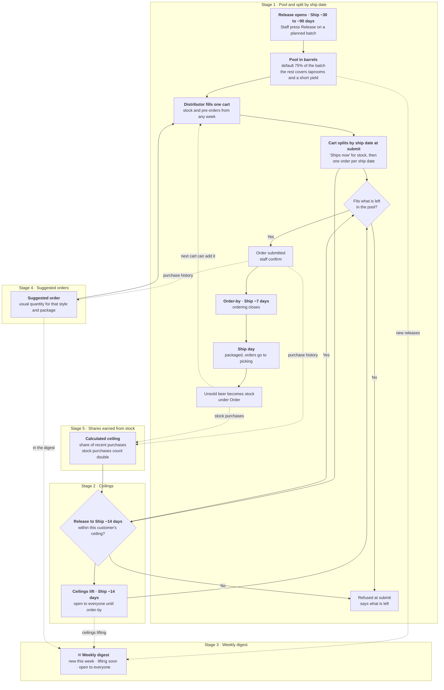

# Release pools, customer ceilings, weekly digest and suggested orders

Owner request, 2026-11-19. Builds on `docs/plans/portal-release-windows.md`
(Phase A: releases, pre-orders, release delay). It replaces that plan's deferred
Phase B (per-customer reserved allocations) with ceilings.

## Status

Built on `feat/portal-order-summary`, 2026-11-19, all five stages. Not committed,
not merged, and not on Production. Both migrations are applied to the dev
database and the test stack.

Differences from the task table below:

- The Releases section has its own view-model and test
  (`lib/mgr/release-settings-view.ts`, `tests/release-settings-view.test.ts`).
- `private.customer_releases` holds what `portal_releases` returns, so the
  digest can read it for every customer.
- The digest's database work is in `lib/email/digest.ts`, handed its service
  client by `lib/email/jobs.ts`, the only email file allowed to make one
  (`.agents/ARCHITECTURE.md`, iron rule 4, updated).
- Confirm order flags a batch **Over pool** when its pool was lowered under
  what is ordered.
- The digest's link opens Pre-order with the suggested quantities filled in
  (`/portal/pre-order?suggested=1`).

## Goal

Twelve distributors order on their own timeline, get enough beer from what is
available, and are rewarded for ordering early. Staff press Release once per
batch; nothing else is routine work.

## Owner decisions (2026-11-19)

1. A batch release is **one number**: barrels open to wholesale. It defaults to
   75% of the planned batch. Every package of the beer draws from that pool.
2. Taprooms and a safety buffer come out of the barrels that are **not**
   released. There is no separate taproom set-aside.
3. A cart **splits by ship date** at submit: stock ships now, and each ship date
   becomes its own order. Nobody's beer is held for a later date.
4. A customer can have a **ceiling**: a percentage of each pool. Ceilings are
   limits, not reservations. A customer who does not order holds no beer.
5. Ceilings **lift 14 days before ship**. Ordering closes 7 days before ship.
   Both are brewery settings, counted back from the ship date.
6. One **weekly digest** email per distributor replaces per-beer emails.
7. The portal can **suggest an order** from a customer's buying habits. The
   buyer always reviews and submits it.
8. Ceilings can be **calculated from recent purchases**, with stock purchases
   counting for more, so clearing stock earns a larger share of new releases.
9. Staff still confirm orders. Automatic confirmation is deferred.

## Flow

## What each stage adds for staff

| Stage | New controls |
| --- | --- |
| 1. Pool and split by ship date | Settings: percent open (75), order-by days (7). Release form: barrels open to wholesale. |
| 2. Ceilings | Settings: days before ship that ceilings lift (14). Customer: release share (%). |
| 3. Weekly digest | Settings: digest day (off by default). |
| 4. Suggested orders | None. |
| 5. Shares earned from stock | Settings: history window in days (blank is off), stock multiplier (2), maximum calculated share (50%). |

All seven settings live in one **Releases** section of Settings. Every stage is
off, or behaves as today, until its setting is filled in: a batch with no pool
keeps unit quantities, a customer with no share has no ceiling, a blank digest
day sends nothing, and a blank history window calculates nothing.

## Data model

Migration `20261119160000_release_pool_ceilings.sql`:

- `batches.wholesale_bbl numeric`: the pool. Null means the batch has no pool.
- `releases.qty` becomes nullable for a batch release: null means no
  per-package limit, only the pool. A stock release still needs a quantity.
- `customers.release_share_pct numeric(5,2)`: a typed ceiling. Null means none.
- `breweries`: `release_open_pct` (75), `release_order_by_days` (7),
  `release_cap_lift_days` (14), `release_digest_dow` (null), 
  `release_share_window_days` (null), `release_stock_multiplier` (2),
  `release_max_share_pct` (50).
- View `release_batch_skus` (security invoker): every active packaged SKU of
  each unpackaged batch's brand, with the batch's planned barrels and pool. It
  replaces `projected_batch_packaging_units` as the release form's source, so
  a batch can be released without batch package shares.

Migration `20261119170000_release_digest.sql`:

- `private.order_email_deliveries.order_id` becomes nullable and the table
  gains `digest_week date`. A row is an order confirmation or a digest, never
  both. One digest per customer user per week.

## Rules, and where each one lives

| Rule | Owner |
| --- | --- |
| Units left on a release: the smaller of its own limit and what the pool still holds, in that package | `private.release_state` |
| An order cannot take a batch past its pool, counted across all its lines | `private.assert_portal_offers` |
| A customer's ceiling: the typed share, else the calculated one, else none | `private.release_shares` |
| Before the lift date, a customer's barrels on a batch stay within their ceiling | `private.assert_portal_offers` |
| Staff-entered orders are not held to ceilings | unchanged: `submit_order` checks offers only for buyers |
| The pool cannot go below confirmed barrels or above the planned batch | `release_sku`, `update_release` |
| One order per ship date | `shipGroups` in `lib/mgr/shop-view.ts`, applied by the portal cart |
| A suggestion never exceeds what is left or the ceiling | `portal_suggested_order` (left), `fitSuggestions` in `lib/mgr/shop-view.ts` (ceiling) |

Calculated share (stage 5), per customer: barrels on confirmed, picked and
shipped wholesale orders in the window, where a line bought from stock counts
`release_stock_multiplier` times. The share is the customer's weighted barrels
over everyone's, kept between 5% and `release_max_share_pct`. A customer with no
purchases in the window has no calculated ceiling.

Suggested quantity (stage 4, revised 2026-11-19 after looking at the order
history): an average of the customer's last six order lines from the past 180
days in which the latest counts most and each one before it half as much. It
uses lines of the same style and package, or of the package alone when the
style has no history. It is less what they already ordered on that release and
capped at what is left. Past order sizes are not used (revised 2026-11-20): an
imported order sometimes merges several can weeks, so only per-beer quantities
are trusted. The Pre-order
page has one button per ship date, and the digest's link fills the soonest date.
The portal then rounds each ship date up to full layers
of a package when that adds no more than a fifth (`fillLayers`), and holds the
result to the customer's ceiling.

Pallets (2026-11-20, from the owner's stacking notes): a pallet is two keg
layers at most, and layers of cases wherever height is left, up to a height
and a weight
(`lib/mgr/pallet-fit.ts`). The numbers are `breweries.pallet_rules`, edited in
the Pallets section of Settings (`set_pallet_rules`): `maxLb` (2,500),
`maxHeightIn` (60, from the floor), `palletHeightIn` (5.5) and `kegLayers`, the
ways one keg layer loads as a count per keg size. A layer is as tall as
`formats.height_in` (a keg layer as tall as its tallest keg). Kegs load in the fewest layers the rows
allow; a size no row names loads by its `pallet_fit`. With no rows, a layer of
one size holds its `pallet_fit` and a shared one counts each keg by
`formats.pallet_fit_mixed`. A unit weighs its beer plus `formats.packaging_lb`;
the beer is the format's barrels times the batch's weight per barrel from its
latest gravity reading (`private.batch_lb_per_bbl`), or 261.3 lb at 1.010 when
there is none. The order summary
says the pallets each order needs and the room left, and **Fill the pallet**
beside a Pre-order ship date tops up the beers already in that order
(`fillPallet`). It guides and never blocks.

## Tasks

Each task starts with its failing test. S = sequential, P = can run in parallel
with its neighbours once its dependency is done.

| # | Task | Files | Test first | Depends |
| --- | --- | --- | --- | --- |
| 1 (S) | Migration: columns, `release_state` with the pool, `release_rows`, `release_sku` with `p_wholesale_bbl`, `update_release` with a nullable quantity and the pool, `assert_portal_offers` pool check, `release_batch_skus`, `set_release_defaults` | `supabase/migrations/20261119160000_release_pool_ceilings.sql` | `tests/release-pool.test.ts`: two packages draw one pool; an order past the pool is refused; the pool cannot drop below confirmed | — |
| 2 (S) | Ceilings and shares in the same migration: `release_shares`, the ceiling check, `portal_releases` with the limit, `portal_release_share`, `portal_suggested_order`, `upsert_customer` with the share | same file | `tests/release-pool.test.ts`: over the ceiling is refused before the lift date and allowed after; a calculated share doubles stock barrels; a suggestion is the median | 1 |
| 3 (P) | Commands | `lib/commands/releases.ts`, `settings.ts`, `customers.ts`, `portal.ts` | covered by 1, 2 and `tests/api-docs.test.ts` | 2 |
| 4 (P) | Release form: barrels open to wholesale, packages as switches, defaults from settings | `lib/mgr/release-view.ts`, `components/mgr/views/release.tsx`, `app/(app)/catalog/release-form.tsx`, Planning and Brand adapters | `tests/release-view.test.ts` | 3 |
| 5 (P) | Settings: Releases section. Customer: release share | `lib/mgr/release-settings-view.ts`, `release-settings-form.tsx`, `lib/mgr/customer-view.ts`, `customer.tsx` | `tests/release-settings-view.test.ts`, `tests/customers-view.test.ts` | 3 |
| 6 (S) | Portal: cart splits by ship date; summary grouped by ship date; Pre-order grouped by ship week | `lib/mgr/shop-view.ts`, `order-summary.tsx`, `shop.tsx`, `app/(portal)/portal/cart.tsx` | `tests/shop-view.test.ts` | 3 |
| 7 (S) | Portal: the buyer's limit and lift date; Use suggested quantities | same as 6 | `tests/shop-view.test.ts` | 6 |
| 8 (S) | Digest: migration, `release_digest_rows`, `queue_release_digest`, text builder, job route, schedule | `supabase/migrations/20261119170000_release_digest.sql`, `lib/mgr/release-digest.ts`, `lib/email/digest.ts`, `app/api/email/jobs/digest/route.ts`, `.github/workflows/hosted-jobs.yml` | `tests/release-digest.test.ts` | 2 |
| 9 (S) | Screens inventory, guides, API docs, operations runbook | `components/mgr/screens.tsx`, `content/docs/staff-guide.mdx`, `portal-guide.mdx`, `docs/operations/order-email-worker.md` | screen proof list | 4 to 8 |

## Deferred, and what would bring each back

| Deferred | Add it when |
| --- | --- |
| Orders that fit confirm automatically | Confirming by hand is the weekly bottleneck |
| A per-customer hold allowance | More than one customer needs beer held, and re-dating one order by hand is not enough |
| "Lift limits now" on a release | Beer sits unsold behind ceilings before the lift date |
| Adding to a customer's existing order for the same ship date | Customers place several orders per ship date |
| Reserved amounts per customer | A customer keeps missing out despite ceilings |
| Storage charge, early-order discount | The softer incentives do not move pickups |
| "Your order is ready" email on ship day | Distributors ask for it |

## Risks

- **Short yield.** The pool is planned barrels, not packaged barrels. The 25%
  that is not released is the buffer. Staff lower the pool, or trim at confirm,
  when a batch packages short by more than that.
- **Digest reaches real inboxes.** It is off until an admin picks a day. Tests
  mock the provider. Do not set a day on a database with real customer logins
  until the copy is approved.
- **Partial submit.** A cart with three ship dates makes three requests. If the
  second fails, the first order exists and the rest stay in the cart with the
  error shown.
- **Landing.** Migrations must sort after every migration on main. The
  branch's earlier ones did not, so they were renamed to `2026111915xxxx` when
  the PR opened (2026-11-20).
- **Limits on a new release with no history.** A calculated limit needs
  purchases in the window. A new customer has none, so they are uncapped until
  a share is typed on their page.
