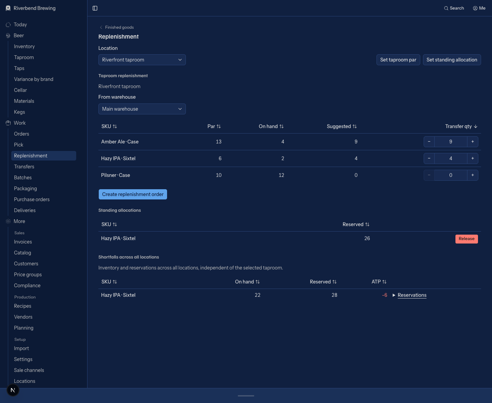

# Replenishment: sortable tables and a clear page hierarchy

Status: implemented, 2026-10-23. Approved proposal and implementation record.
Branch: `plan/replenishment-table`, created from local `main` at `130ceb81`.
Any PR targets `main`.

## Goal

Make replenishment as scannable as Finished goods without changing stock,
allocation, or transfer rules. Reuse the existing sortable-table implementation.



## Evidence

Inspected the live `/replenishment` and `/inventory` pages on this branch's
local server. The current local replenishment data rendered 21 shortfall
sections and 22 `h1` headings. The Location picker began about 4,805px below
the viewport top at scroll position zero. The screenshot is a local planning
artifact at `/tmp/replenishment-plan-before.png`, not a committed fixture.

`app/(app)/replenishment/page.tsx` repeats `ParsView` for every global shortfall
before rendering the location picker and replenishment form. Each instance
adds another Finished goods back link, heading, ATP headline, and reservation
list. This is the main source of page length.

`app/(app)/replenishment/replenish-form.tsx` already draws SKU, Par, On hand,
Suggested, and Transfer qty in a table. That table uses local HTML instead of
the shared sorting and responsive presentation.

The inventory record named `Pars and allocation` in
`components/mgr/screens.tsx` currently shows only the single-SKU `ParsView`.
It does not represent the complete live replenishment page. Fix this specific
parity gap as part of the cleanup, not as a separate screen redesign.

## Proposed design

One page title: **Replenishment**, matching the sidebar. One Finished goods
back link. Three sections with explicit scopes, in this order:

### 1. Taproom replenishment

Keep the Location picker near the top, before any repeated records.
Keep Set taproom par and Set standing allocation alongside this section.
Keep From warehouse above the editable table and Create replenishment order
below it, with the existing error and missing-input messages.

| Column | Meaning | Interaction |
| --- | --- | --- |
| SKU | Existing SKU name, including its format | Sort by name |
| Par | Target for the selected taproom | Numeric sort |
| On hand | Stock at the selected taproom | Numeric sort |
| Suggested | Existing query's suggested quantity | Numeric sort |
| Transfer qty | Quantity to request from the selected warehouse | Existing E quantity editor; numeric sort on the current draft value |

Use SKU-name ascending as the initial row order. A saved browser sort takes
precedence through the existing shared behavior. Do not invent a priority or
urgency score. Suggested descending is available through a header click.
Quantities are SKU units, not a cross-format volume comparison.

### 2. Standing allocations

Keep this distinct from par and transfer quantity. Render a compact table
with SKU, Reserved, and an unlabeled Release action column. Keep the
`standing-allocations` anchor. Preserve the existing release confirmation,
quantity, authorization, errors, and ATP semantics.

### 3. Global shortfalls

Label the section **Shortfalls across all locations**. Do not let the taproom
picker imply that these figures belong to the selected taproom.

Replace the repeated full-screen `ParsView` blocks with one compact table:
SKU, On hand, Reserved, ATP, and an unlabeled reservation-detail action.
Sort quantities numerically and SKU names naturally using the shared sorter.
Use SKU-name ascending as the initial order, not a new business ranking.

Show reservation details only for a SKU being reviewed. Use a disclosure in
the action cell rather than a second page-level heading or a new route.
Keep each reservation's named quantity and existing Review destination:
order reservations open their order, and standing reservations open the
selected taproom's `#standing-allocations` section. Keep unit and existing
volume context in the detail; do not add converted volume columns.

Preserve `?sku=` as a filter on global shortfalls only. A link from Finished
goods should target this section with an anchor so its requested context is
immediately visible. For a filtered SKU, open its reservation detail by
default. Keep the no-current-shortfall message. All shortfalls clears only
the SKU filter and retains an explicitly selected location. Keep existing
unanchored inbound URLs functional; the filtered context remains rendered.

## Reuse and ownership

- `components/mgr/views/record-table.tsx`: use `RecordTable` for responsive
  desktop tables and labeled phone records. It already supports explicit
  numeric sort values, SKU-keyed rows, and action cells.
- `components/mgr/sort-head.tsx` and `lib/mgr/table-sort.ts`: keep their header
  controls, natural/numeric comparisons, and per-browser sort persistence.
  Do not add another sorting hook, storage key system, or dependency.
- `components/mgr/e.tsx`: retain E pickers, quantity editors, actions, empty
  states, and headings. Do not add native selects or number inputs.
- `lib/replenishment-form.ts`: retain `replenishmentLines` and
  `replenishReason` for payload selection and submit availability.
- `app/(app)/replenishment/quantity-form.tsx`: retain the existing par,
  standing-allocation, and release flows. This is not a form redesign.
- Add a focused shared replenishment view under `components/mgr/views/`,
  with a pure adapter under `lib/mgr/` and fictional inventory fixtures.
  The view owns all three sections, table columns, and responsive layout.
  Named action bindings may supply existing command dialogs; a slot must
  not replace a whole table or section with separately drawn live markup.
- Keep reads, roles, command execution, request IDs, and server refresh at
  the existing live boundaries. Inventory interactions are local simulations.

Target composition:

`Pars and allocation inventory record → shared replenishment view ← /replenishment page + client command bindings`

Retain the inventory record's internal name to avoid an unrelated rename.
Update its drawing, read/write annotations, states, and action mappings to
cover the actual page. Both surfaces display the Replenishment title.
Do not edit generated docs inventory pages by hand.

## State invariants

- Draft transfer quantities remain keyed by `skuId`, never display index.
  Sorting must not move an entered quantity onto another SKU.
- Sorting does not submit a form or discard edits. Clearing an editor remains
  a draft empty value; it is not silently replaced with the suggestion.
- Explicit Transfer qty sort values come from current draft quantities, not
  React input text extraction. Empty draft values sort as missing.
- RecordTable renders desktop and phone branches. Editors need distinct DOM
  IDs in those branches while reading and writing the same SKU-keyed state.
  Do not duplicate a fixed input ID or share row-local state by position.
- Use explicit numeric sort values for cells containing components or detail
  controls. Hidden reservation text must not change the SKU's sort value.
- Preserve first-taproom and first-eligible-warehouse defaults. A destination
  with Warehouse use still cannot be its own source.
- Admin and Sales keep mutation access. Warehouse remains read-only.
- Do not filter out zero suggestions. They remain visible and editable.
- Preserve suggestions after par changes, allocation warnings, release
  confirmations, disabled-submit reasons, and retained inputs after errors.
- Global ATP and selected-taproom on hand never become the same field.

## Implementation sequence

### 1. Shared page presentation and inventory

Build the shared page from the proposed hierarchy using RecordTable and E.
Replace the inventory record's single-SKU drawing with the complete shared
view and fictional data. Cover populated, no-taproom, no-par, no-shortfall,
no-standing-allocation, missing-source, filtered-SKU, and read-only states.
Do not introduce a schema gate: this design uses existing returned facts.

Acceptance: inventory renders one page heading; the selected taproom and
replenishment controls precede shortfall rows; reservation details do not
expand the entire shortfall list by default.

### 2. Live binding and clean cutover

Wire the current page reads and client command behavior into that same view.
Remove the old local table and repeated shortfall screen composition once
all their behavior is represented. Check references before changing exported
symbols or removing obsolete code. Do not delete files still used elsewhere.
Update Finished goods shortfall links and preserve inbound filter/anchor
behavior. Keep par and allocation dialogs at their existing command boundary.

Acceptance: the inventory and live route mount the same presentation;
existing commands receive the same SKU IDs and quantities regardless of
sorting; unrelated screens and business rules are unchanged.

### 3. Behavior proof and documentation

Before implementing uncertain logic, extend the existing appropriate tests:
`tests/replenishment-form.test.ts`, `tests/record-table.test.ts`,
`tests/dependency-page-adapters.test.ts`, and the screen composition checks.
Use a failing case for the consumer-visible bug or transition being covered.
Do not add tests that merely assert imported symbols or exact JSX positions.
Replace affected position-based assertions with behavioral checks; remove
obsolete wording/implementation assertions rather than pinning new markup.

Key cases:

- Edit two different SKUs, sort in both directions, and submit: each entered
  quantity stays with its SKU; zero lines remain excluded.
- Transfer quantity sorts numerically on the draft value, including empty,
  zero, decimal, 2, and 10; sorting never submits.
- Changing location keeps the SKU filter, and All shortfalls keeps location.
- Review destinations still distinguish orders from standing reservations.
- Warehouse cannot mutate through the new presentation.
- The composition gate follows both surfaces into the shared page drawing.

Update `content/docs/staff-guide.mdx` under Taproom replenishment with the
new hierarchy, numeric sorting, retained sort, and reservation disclosure.
Update affected screen links and parity expectations without blanket
exceptions. No API generation is needed unless actual command metadata
changes; declarations should describe existing operations accurately.

Run the screen-only proof:

```sh
bunx tsc --noEmit
bun run lint
bunx vitest run tests/mgr-screens.test.ts tests/tap-coverage.test.ts tests/screen-links.test.ts tests/theme-contrast.test.ts tests/screen-persona.test.ts tests/design-docs.test.ts tests/docs.test.ts
```

Also run the affected replenishment, adapter, table, and composition tests.
Run simplify and the repository's readability/behavior-preservation review
before committing code, then repeat the required proof after any edits.

Browser proof on the implemented surface is required, not just tests:

1. Open live and inventory at desktop and phone widths.
2. Confirm Location is visible without scrolling through global shortfalls.
3. Edit different SKU quantities, sort, and observe their identities stay put.
4. Reload and observe the saved sort; check phone labels and editor focus.
5. Follow a Finished goods shortfall link, review an order, and follow a
   standing-allocation reservation to the correct taproom and anchor.
6. Exercise par save, allocation save/warning, release, and replenishment
   order creation on explicitly identified local test data only.
7. Confirm the order is already confirmed and ready for picking; no invoice
   or stock movement is invented by this page cleanup.
8. Capture screenshots and close the named browser session.

If implementation touches commands, RPCs, or schema, stop treating it as
screen-only and run the repository's full proof instead.

## Out of scope

No new stock projections, source ATP column, demand forecast, business
priority, auto-replenishment, bulk allocation edits, tabs, search/filter
framework, server-side sorting, dependency, schema, or command change.
No redesign of stock-transfer documents or their fulfillment flow.

## Verification

Before implementation, the updated live-adapter cases failed on the old
page's missing complete view model. After integration, the live route and
inventory mount the same `ReplenishmentView`; the obsolete `ParsView` drawing
is removed while its unit/volume adapter remains in use for reservation detail.

Browser proof used an isolated fictional tenant on the local dev stack
(API 54341, database 54342). The finished page has one `h1`; Location began
at about 159px instead of 4,805px in the baseline viewport.

- Edited two SKU quantities, sorted Transfer qty, then created a confirmed
  taproom-transfer order. Read the order back: Amber 10, Hazy 2, no zero line.
  The selected taproom's stock remained 4, 2, and 12 units.
- Changed par from 12 to 13 and observed the suggestion refresh from 8 to 9.
- Saved a standing allocation past ATP, observed Allocation saved and the
  negative-ATP warning, then released that allocation through confirmation.
- Checked filtered shortfall disclosures and order/standing Review destinations.
  Clearing the SKU filter retained location and a transfer draft of 7.
- Checked live phone layout at 390px: no horizontal overflow, visible labeled
  editors, and distinct IDs for desktop/phone instances.
- Signed in as Warehouse: all six responsive transfer inputs disabled, no
  submit button, and no mutation actions.
- Exercised the inventory frame's controlled edits, numeric sorting of 2 and
  10, and an empty draft via keyboard deletion. Empty stayed empty and sorted
  last. Reload restored the saved sort, not unsaved quantities.

The correctness review found one draft-loss issue in the initial native
All shortfalls link. Switching it to Next Link fixed the browser scenario;
the reviewer confirmed closure. Independent readability and behavior-preservation
review found no remaining high-confidence issues. Explicit Haiku selection
was unavailable in this harness; that review used the default reviewer model.

Local proof passed: TypeScript, lint (zero errors; seven warnings in untouched
files), 331 tests across 18 screen/affected regression files, and 55 API-doc
compatibility tests. Full CI remains the gate for marking the PR ready.
No schema, RPC, command implementation, or dependency changed. Throwaway
smoke scripts were removed; the committed screenshot contains only fictional
local data.
